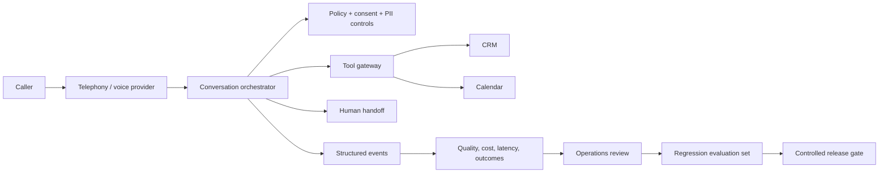

# Voice AI Deployment Lab

[](https://github.com/Maneshwar-Kumar/voice-ai-deployment-lab/actions/workflows/ci.yml)
[](https://github.com/Maneshwar-Kumar/voice-ai-deployment-lab/actions/workflows/deploy-pages.yml)

An interactive, provider-neutral workbench for taking an enterprise voice-AI opportunity from **customer discovery to controlled production**.

This is a deployment-strategy demonstration, not a claim that a live contact centre is connected. The public demo uses deterministic sample calls and transparent assumptions. A reference FastAPI service shows how the same operating model can sit behind a real voice provider without exposing credentials in the browser.

**Live demo:** https://maneshwar-kumar.github.io/voice-ai-deployment-lab/

## The scenario

An automotive retail group wants an AI voice agent to qualify inbound service leads and book workshop appointments. The technology must work with the existing CRM and calendar, support multilingual callers, hand off safely to humans, and produce measurable commercial value without compromising customer trust.

The lab helps a deployment team answer five questions:

1. **Is this the right workflow?** Assess value, feasibility, risk, and change readiness before writing code.
2. **What must integrate?** Make CRM, calendar, telephony, consent, analytics, and escalation contracts explicit.
3. **How will quality be proven?** Define offline evaluations and live operating gates before launch.
4. **How should rollout proceed?** Move through shadow, assisted, limited-production, and scale stages with rollback criteria.
5. **How will it run safely?** Instrument latency, containment, transfer success, policy violations, cost, and business outcomes.

## What the demo includes

- An interactive deployment brief and transparent value model
- Reference architecture and integration-contract map
- A deterministic call simulation with safety and escalation outcomes
- Evaluation scorecard and go/no-go gates
- Phased rollout plan with ownership and rollback triggers
- Risk register covering consent, PII, hallucination, integrations, and adoption
- Operations dashboard and incident-response runbook
- A provider-neutral FastAPI reference service
- Unit, API, contract, and policy tests
- Linting, coverage, dependency review, container build, and secret scanning in CI
- GitHub Pages continuous deployment for the public workbench
- A production deployment blueprint using container images and workload identity

## Architecture



See [the architecture decision record](docs/ARCHITECTURE.md) and [deployment playbook](docs/DEPLOYMENT_PLAYBOOK.md) for the operating detail.

## Run locally

### Interactive workbench

The front end is static and requires no credentials:

```bash
python -m http.server 8000 --directory web
```

Open `http://localhost:8000`.

### Reference API

```bash
python -m venv .venv
python -m pip install -e ".[dev]"
uvicorn voice_ai_deployment_lab.app:app --reload
```

API documentation is available at `http://localhost:8000/docs` when the service is running.

### Quality checks

```bash
ruff check .
pytest --cov=voice_ai_deployment_lab --cov-report=term-missing --cov-fail-under=90
```

## Deliberate boundaries

- No real customer data or client-confidential workflow is included.
- No provider key is required for the public demo.
- Sample calls are explicitly marked as simulations.
- Business-case outputs are directional and show every assumption.
- The provider adapter boundary is intentionally small so ElevenLabs or another platform can be integrated server-side without redesigning the operating model.

## Repository map

```text
web/                         interactive GitHub Pages demo
src/voice_ai_deployment_lab/ reference API, planner, and provider contract
tests/                       unit, API, contract, and policy tests
docs/                        architecture, deployment playbook, runbook, demo script
.github/workflows/           continuous integration and Pages deployment
Dockerfile                   production-style container image
```

## Deployment philosophy

The difficult part of enterprise voice AI is not generating a voice response. It is selecting a workflow with enough value, designing reliable system boundaries, agreeing on quality thresholds, handling failure safely, winning user trust, and creating a release process that improves without surprising customers.

That is what this lab is designed to demonstrate.

## Licence

MIT. See [LICENSE](LICENSE).

