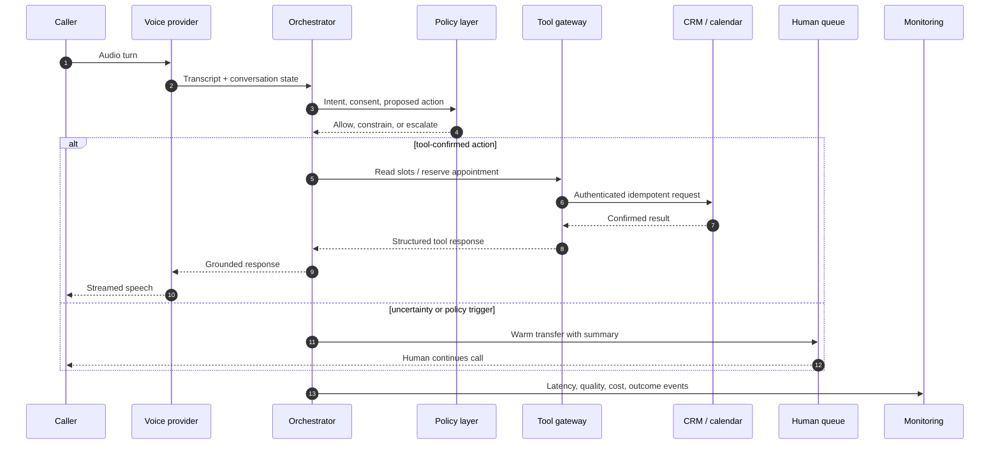

# Architecture decision record

## Decision

Separate the customer-facing deployment logic from the voice-provider integration behind a narrow adapter contract.

## Why

An enterprise deployment should not hard-wire business policy, CRM behaviour, evaluation criteria, or observability to one model or telephony provider. The voice platform is important, but it is one component of a larger operating system.

## Component responsibilities

| Component | Owns | Must not own |
|---|---|---|
| Voice provider | speech, turn-taking, streaming | customer master data |
| Orchestrator | state, tool selection, response plan | raw credentials |
| Policy layer | consent, prohibited actions, escalation | business-system writes |
| Tool gateway | schemas, authentication, retries, idempotency | open-ended model reasoning |
| CRM/calendar | source-of-truth records and slots | conversational policy |
| Monitoring | events, alerts, quality sampling | unrestricted transcript access |

## Reliability choices

- A booking is never stated as confirmed until the calendar write succeeds.
- Tool writes carry idempotency keys so retries cannot create duplicate appointments.
- External calls have timeouts and circuit breakers.
- Degraded mode captures a callback instead of inventing availability.
- Human transfer is treated as a core product path, not a failure.
- Release gates combine technical, safety, customer, and commercial metrics.

## Provider integration boundary

The public repository supplies a deterministic provider for repeatable demonstrations. A production adapter would translate provider webhooks into the same request model and map approved responses back to the provider API. Credentials stay server-side in a managed secret store.

